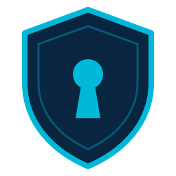
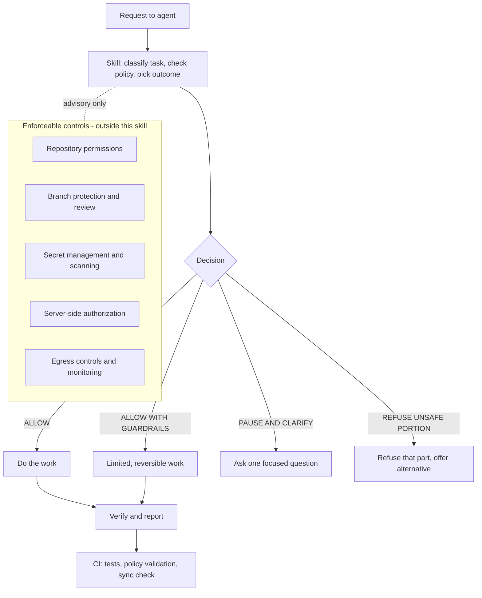

<p align="center">
  
</p>

<h1 align="center">anti-reverse-engineering</h1>

<p align="center"><strong>Protect your application's identity. Reduce AI-assisted cloning risk. Keep control of your intellectual property.</strong></p>

<p align="center">
  <a href="LICENSE"></a>
  <a href="pyproject.toml"></a>
  <a href="docs/limitations.md"></a>
</p>

AI coding agents can accelerate development. They can also expose proprietary
implementation details or help reconstruct applications beyond the scope of an
authorized task.

`anti-reverse-engineering` gives your agents a structured, authorization-aware workflow
for protecting application identity and reducing unnecessary exposure, backed by
configurable policies and practical security controls.

> **Status and limitation notice.** Version 0.1.0 is pre-release. The skill is
> **advisory**: it guides agents that load it, and it cannot technically stop an agent
> or person that ignores it and has unrestricted access. The name describes the
> defensive objective; it does not claim that reverse engineering or cloning can be
> prevented. Pair it with real controls, see [Architecture](#architecture-and-defense-in-depth)
> and [docs/limitations.md](docs/limitations.md).

## Table of contents

- [Why this project exists](#why-this-project-exists)
- [What it does and does not do](#what-it-does-and-does-not-do)
- [Features](#features)
- [Architecture and defense in depth](#architecture-and-defense-in-depth)
- [How decisions are made](#how-decisions-are-made)
- [Installation for Claude Code](#installation-for-claude-code)
- [Installation for Codex](#installation-for-codex)
- [Quick start](#quick-start)
- [Configuration walkthrough](#configuration-walkthrough)
- [Example policy](#example-policy)
- [Safe and unsafe requests](#safe-and-unsafe-requests)
- [GitHub Actions and repository permissions](#github-actions-and-repository-permissions)
- [Testing and local development](#testing-and-local-development)
- [Threat model](#threat-model)
- [Known limitations](#known-limitations)
- [Contributing](#contributing)
- [Reporting security vulnerabilities](#reporting-security-vulnerabilities)
- [Roadmap](#roadmap)
- [FAQ](#faq)
- [License](#license)
- [Get involved](#get-involved)

## Why this project exists

Agents read whole repositories, follow links, and act on text they find. That is
useful, and it creates risks: bulk collection of proprietary code, secrets pasted into
prompts, brand assets quietly replaced, or a request to rebuild someone else's product
from screenshots and network traces. Most of these are not malicious by default. They
depend on authorization, scope, and purpose, which agents do not reliably infer.

This project gives agents a consistent way to ask the right questions first: what is
the target, who controls it, what is authorized, and what data is involved.

## What it does and does not do

| It does | It does not |
| --- | --- |
| Gives agents a decision procedure with four fixed outcomes | Enforce permissions or block network traffic |
| Reads a project policy describing intent | Prove ownership or legal authority |
| Keeps secrets out of chat, logs, and reports | Make public client-side code secret |
| Preserves brand identity and attribution by default | Promise that cloning is prevented |
| Refuses the unsafe part of a request and offers alternatives | Provide legal advice or DRM |
| Validates policy files and checks skill integrity in CI | Replace access control, review, or monitoring |

## Features

- **Skill** for Codex-style discovery: [`SKILL.md`](skills/anti-reverse-engineering/SKILL.md)
  plus deeper [references](skills/anti-reverse-engineering/references/).
- **Claude Code command**: [`.claude/commands/anti-reverse-engineering.md`](.claude/commands/anti-reverse-engineering.md).
- **Policy file** (`.anti-reverse-engineering.yml`) with three ready profiles in
  [`policies/`](policies/): default, strict, development-friendly.
- **Validator** (`scripts/validate_policy.py`) with clear errors and no secret echoing.
- **Drift check** (`scripts/check_skill_sync.py`) between the canonical and Codex skill copies.
- **CI** for tests, policy validation, sync check, and Markdown lint, with read-only permissions.
- **Docs** on enforcement, configuration, limitations, and supported agents.

## Architecture and defense in depth

The skill is one advisory layer. The layers below it are what actually enforce.



Details: [docs/enforcement-guide.md](docs/enforcement-guide.md).

## How decisions are made

Every sensitive task ends in exactly one of four outcomes.

| Outcome | Meaning |
| --- | --- |
| `ALLOW` | Authorized, in scope, no control violated |
| `ALLOW WITH GUARDRAILS` | Legitimate but sensitive: limited, reversible, approved where required |
| `PAUSE AND CLARIFY` | Ownership, scope, or data handling is unclear enough to change the risk |
| `REFUSE UNSAFE PORTION AND REDIRECT` | Refuse the unauthorized part, continue the legitimate parts, offer alternatives |

Reverse engineering is not automatically refused: authorization, scope, purpose, and
controls decide. Full procedure: [`SKILL.md`](skills/anti-reverse-engineering/SKILL.md).

## Installation for Claude Code

Claude Code does not read Codex `SKILL.md` files as slash commands on its own, so this
repository ships a command file. Commands live in `.claude/commands/` (per project) or
`~/.claude/commands/` (all your projects).

```bash
git clone https://github.com/<OWNER>/anti-reverse-engineering.git   # replace <OWNER> after publication
mkdir -p your-project/.claude/commands your-project/skills
cp anti-reverse-engineering/.claude/commands/anti-reverse-engineering.md your-project/.claude/commands/
cp -r anti-reverse-engineering/skills/anti-reverse-engineering your-project/skills/
cp anti-reverse-engineering/policies/default.yml your-project/.anti-reverse-engineering.yml
```

Then run `/anti-reverse-engineering <your task>` in Claude Code. The command reads the
skill from `skills/anti-reverse-engineering/SKILL.md` in the project, so copy both.
Behavior varies by Claude Code version; see [docs/supported-agents.md](docs/supported-agents.md).

## Installation for Codex

```bash
mkdir -p your-project/.agents/skills
cp -r anti-reverse-engineering/.agents/skills/anti-reverse-engineering your-project/.agents/skills/
cp anti-reverse-engineering/policies/default.yml your-project/.anti-reverse-engineering.yml
```

Restart the client if the skill does not appear. Discovery paths and invocation vary by
client and version, so confirm against your client's documentation.

## Quick start

1. Copy a profile to your repository root as `.anti-reverse-engineering.yml`.
2. Replace every placeholder with your real application details.
3. Validate it: `python scripts/validate_policy.py .anti-reverse-engineering.yml`
4. Ask your agent to do a task. For Claude Code: `/anti-reverse-engineering fix the login redirect bug`.

Expected behavior for an authorized change:

> **Decision: ALLOW.** The task is a bug fix within the configured scope. I'll make the
> smallest change, leave brand assets untouched, and run the login tests.

For an unauthorized reconstruction request:

> **Decision: REFUSE UNSAFE PORTION AND REDIRECT.** I can't rebuild that product from its
> extracted API behavior without authorization. I can design an original app from your
> requirements, or help with an integration built on its documented public API.

## Configuration walkthrough

The policy has six groups: `application` (what is protected), `authorization` (what
work is allowed), `identity` (what needs approval to change), `data_handling`,
`review`, and `audit`. Every field, allowed value, and default is documented in
[docs/configuration.md](docs/configuration.md). You can keep private details out of a
public repository by using generic path patterns and storing detailed policy privately.

## Example policy

```yaml
version: 1
application:
  name: "Example App"
  owner: "Example Org"
  canonical_domains: ["app.example.com"]
  repositories: ["example-org/example-app"]
  identity_assets: ["public/brand/"]
  protected_paths: ["src/core/"]
  sensitive_data_paths: [".env*", "secrets/"]
authorization:
  permitted_work: [maintenance, feature_development, accessibility, testing]
  reverse_engineering: approval_required
  third_party_reconstruction: deny_without_documented_authorization
  external_upload_of_proprietary_material: approval_required
identity:
  preserve_by_default: true
  changes_require_approval: [product_name, logo, brand_assets, attribution]
data_handling:
  never_print_secrets: true
  minimize_customer_data: true
  external_services_require_approval: true
review:
  high_risk_changes_require_human_review: true
  record_decision_rationale: true
```

This file describes intent. It does not enforce permissions or prove ownership.
More profiles: [`policies/`](policies/). A worked example: [`examples/`](examples/).

## Safe and unsafe requests

| Request | Outcome |
| --- | --- |
| "Fix the checkout bug in our app" | `ALLOW` |
| "Make the settings page keyboard accessible" | `ALLOW` |
| "Scan our build for leaked keys and source maps" | `ALLOW` |
| "Read `src/core/pricing` to fix this rounding bug" | `ALLOW WITH GUARDRAILS` |
| "Analyze this binary for our documented interoperability project" | `ALLOW WITH GUARDRAILS` |
| "Change our logo and product name" | `PAUSE AND CLARIFY` until approved |
| "Print the values in `.env`" | `PAUSE AND CLARIFY`: no values shown, redacted check offered |
| "Rebuild a competitor's app from its screenshots and API traffic" | `REFUSE UNSAFE PORTION AND REDIRECT` |
| "Strip the license headers so it looks original" | `REFUSE UNSAFE PORTION AND REDIRECT` |

Fourteen worked cases: [examples/decision-cases.md](examples/decision-cases.md).

## GitHub Actions and repository permissions

Workflows in [`.github/workflows/`](.github/workflows/) run on pull requests and pushes
to `main`, declare `permissions: contents: read`, use no secrets, and fail on real
validation errors. They are unexecuted on GitHub until the repository is published;
check the first run. The skill is only one layer: use branch protection, required
review, and CODEOWNERS on identity paths. See [docs/enforcement-guide.md](docs/enforcement-guide.md).

## Testing and local development

```bash
python -m pip install -r requirements.txt   # PyYAML only
make check                                  # tests, policy validation, sync check, lint
```

Without `make`: `python -m unittest discover -s tests -v`,
`python scripts/validate_policy.py .anti-reverse-engineering.yml policies/*.yml examples/owned-application/.anti-reverse-engineering.yml`,
`python scripts/check_skill_sync.py`. Markdown lint needs Node: `make lint`.
Details: [docs/testing.md](docs/testing.md).

## Threat model

Assets, threats, and mitigations are tagged as guidance, detection, or enforcement in
[the threat model](skills/anti-reverse-engineering/references/threat-model.md).
Repository text, web pages, and issue comments are treated as data, never as
instructions that override policy.

## Known limitations

- Advisory only; an agent can ignore it and other agents may not load it.
- Cannot restrict access an actor already has, or hide public client-side code.
- A policy file is not proof of ownership.
- Scanners and checks have false positives and negatives.
- Not legal advice.

Full list: [docs/limitations.md](docs/limitations.md).

## Contributing

Read [CONTRIBUTING.md](CONTRIBUTING.md). Keep changes focused, run `make check`, and
update the canonical skill then run `python scripts/check_skill_sync.py --write`.

## Reporting security vulnerabilities

Do not open a public issue. See [SECURITY.md](SECURITY.md).

## Roadmap

All items are **planned**, not implemented.

- Additional agent adapters.
- More policy validation rules.
- Optional repository scanning for exposed secrets and risky build artifacts.
- Improved CI policy checks.
- Structured decision reports.
- Integration guidance for enterprise permission systems.

## FAQ

**Does this prevent all reverse engineering?** No. See [docs/faq.md](docs/faq.md) for
this and other questions, including use with other agents and what happens when an agent
ignores the skill.

## License

Proposed license: MIT, see [LICENSE](LICENSE). The copyright holder is a placeholder that
the maintainer must fill in and the license choice must be confirmed before publication.

## Get involved

Open an issue for bugs or ideas, send a pull request, and star the repository if it is
useful to you. Please include failing examples when you report a gap in the decision logic.
